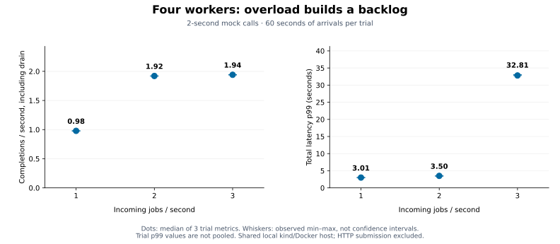
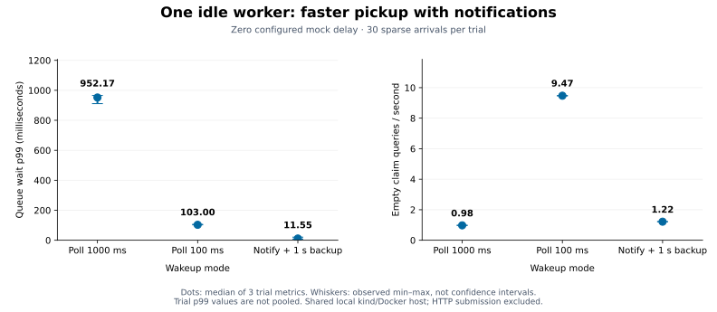
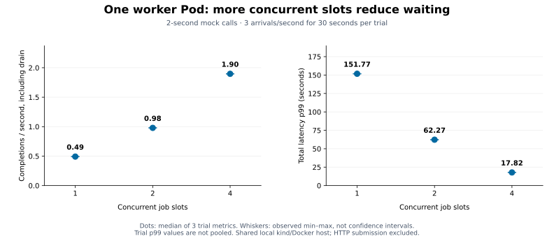

# M6 findings: capacity, wakeups and concurrency

EvalFlow keeps the queue in Postgres and executes LLM jobs asynchronously. These local experiments
ask where time goes when arrival rate, worker count, wakeup policy or in-process concurrency changes.
They use deterministic mock calls rather than a live provider. The [architecture diagram](../../README.md#architecture)
shows the durable queue, worker pipeline, recovery, autoscaling and monitoring boundaries.

## Processing capacity and backlog



Four worker Pods, one slot each, and two-second mock calls give an ideal service rate of two jobs/s
before pipeline overhead. Increasing arrivals from one to two to three jobs/s produced median batch
completion rates of 0.98, 1.92 and 1.94 jobs/s, including drain. Total p99 was 3.01, 3.50 and 32.81 seconds.
At three arrivals/s, execution p99 stayed near 2.03 seconds while the sampled queued count peaked at
60–63 jobs. The extra latency accumulated before execution: arrivals exceeded configured capacity.

This is evidence of the configured workload reaching its slot/service-time limit. It does not identify
Postgres's maximum throughput. The earlier worker-count experiment offered only one job/s, so spare
workers could reduce waiting without demonstrating their full capacity.

Evidence: [nine-trial sweep](2026-10-18-capacity-sweep.md), [raw trials](2026-10-18-capacity-sweep.json);
[exploratory 1/2/4-worker baseline](2026-10-18-fixed-workers.md).

## Waking an existing idle worker



With one warm worker and zero configured mock delay, median trial queue-wait p99 was 952.17 ms for
one-second polling, 103.00 ms for 100 ms polling, and 11.55 ms for notifications with a one-second
backup. Empty claim query rates were 0.98, 9.47 and 1.22 per second respectively. All conditions used
the same migrated image with the notification trigger installed and identical sparse arrival offsets.

Notifications improved pickup while avoiding most of the extra empty queries of faster polling.
They add a dedicated listener connection per process, reconnect handling and missed-wakeup protection;
backup checks remain necessary for disconnected listeners and delayed retry eligibility. The claim
counter excludes trigger/notification overhead and other SQL, so this is not a total database CPU or
cost comparison. Polling remains the default; notification mode is opt-in.

These are existing-worker wakeups. At zero replicas there is no listener; KEDA must detect demand
on a later poll and start a Pod. This experiment does not measure that cold-start path.

Evidence: [same-build nine-trial comparison](2026-10-18-wakeup-comparison.md),
[raw trials](2026-10-18-wakeup-comparison.json). The [earlier polling-only experiment](2026-10-18-idle-polling.md)
used an older image and is retained separately rather than substituted as a control.

## Concurrent slots inside one Pod



One Pod with fixed image, resources and one-second polling ran 1/2/4 concurrent slots. With two-second
mock calls and three arrivals/s, median completion rates including drain were 0.49/0.98/1.90 jobs/s.
Total p99 fell from 151.77 to 62.27 to 17.82 seconds; execution p99 stayed around 2.02–2.04 seconds.
Observed pipeline overlap reached each configured slot count. More slots overlapped the mock waits,
reducing backlog, but arrivals still exceeded every setting's ideal 0.5/1/2 jobs/s capacity.

This supports concurrency for this waiting-heavy mock workload with these fixed resources. It does
not show equivalent gains for CPU-heavy work or a real provider with shared rate limits. It is also
not a matched one-Pod-versus-four-Pod efficiency comparison: the separate experiments used different
windows and images. Pool sizing, CPU saturation and claim contention were not independently isolated.

Evidence: [nine-trial report](2026-10-18-concurrency.md), [raw trials](2026-10-18-concurrency.json).

## Measurement boundaries

- Dots show the median of three trial-level metrics; whiskers show their observed minimum and maximum.
  Trial p99 values are not pooled. Three repetitions and small sparse batches cannot establish a stable
  population p99; the ranges are not confidence intervals.
- Trials ran on a shared local kind/Docker host. KEDA was paused; worker identity, readiness, settings,
  image identity and clock checks were enforced. Warmup and full drain separated trials, and original
  worker/scaling settings were restored. Results are not production capacity guarantees.
- The producer inserts normal durable queue jobs directly into Postgres, using dataset snapshots and
  deterministic mock settings. HTTP submission and real-provider behavior are excluded. Workers still
  execute the normal tools, LLM wrapper, validation, evaluation and persistence path.
- Queue latency is `startedAt - createdAt`; execution latency is `completedAt - startedAt`; total is
  `completedAt - createdAt`, including waiting. The completion marker precedes final job/eval writes
  and commit, so those transaction tails are excluded. Batch throughput includes initial pickup and
  the full drain, including a possible partial final wave. Queue maxima are sampled.
- Accepted full trials required every measured job to complete with one attempt and one evaluation,
  alongside timing and worker checks. Invalid smoke runs with large database/monotonic clock gaps
  were rejected, including one expired-lease failure; their artifacts remain locally for inspection.
  A three-probe clock-alignment preflight was added before the accepted concurrency run.
- No conclusion is made about database pool saturation, lock/claim contention, total database cost,
  CPU saturation, real-provider/token quotas or a production maximum. Those require separate controlled
  experiments and resource measurements. Autoscaling behavior is documented in [M5](../../README.md#local-worker-autoscaling),
  not inferred from these fixed-capacity measurements.

## Reproduce the figures

The JSON archives are the input; no running cluster or new benchmark is needed to redraw the charts.
Node recomputes summaries from raw trials with the existing report modules and rejects invalid or
incomplete comparisons. Matplotlib renders the resulting medians and ranges.

```bash
uv run benchmarks/charts.py
uv run benchmarks/charts.py --check
# Optional PNG previews for visual inspection:
uv run benchmarks/charts.py --check --preview-dir /private/tmp/evalflow-m6-charts
pnpm test:benchmark
```

Run from the repository root. The script pins Matplotlib via inline uv dependencies; the first run
requires downloading its plotting environment. `--check` compares deterministic SVG bytes against the
saved figures. The generator fixes SVG metadata/hash salt and uses the bundled DejaVu Sans font;
use the same plotting version/environment when checking exported artifacts. Source JSON/Markdown
archives stay unchanged. For fresh workloads, controls, cleanup and rejected-run handling, follow the
[benchmark protocols](../../benchmarks/README.md).
